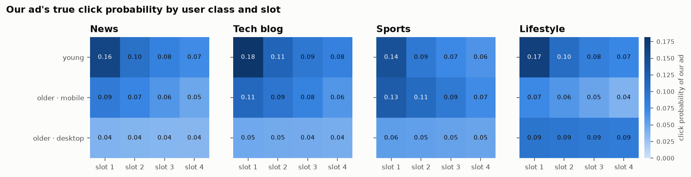
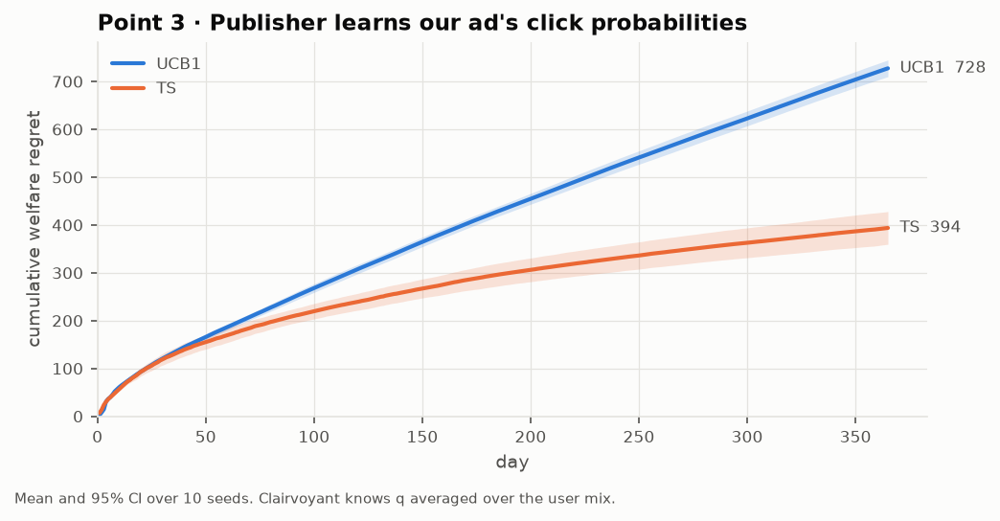
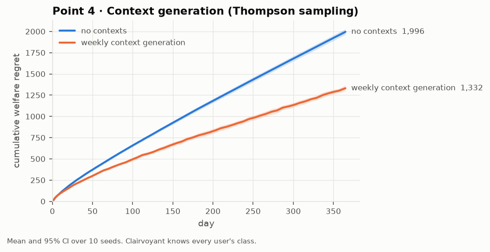
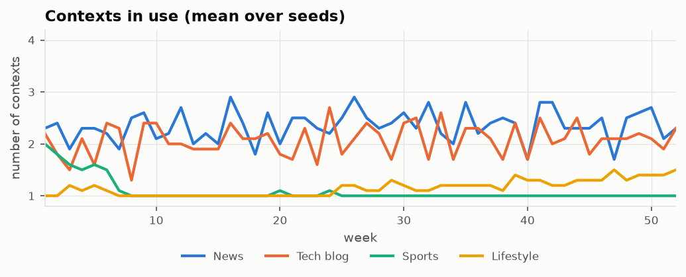
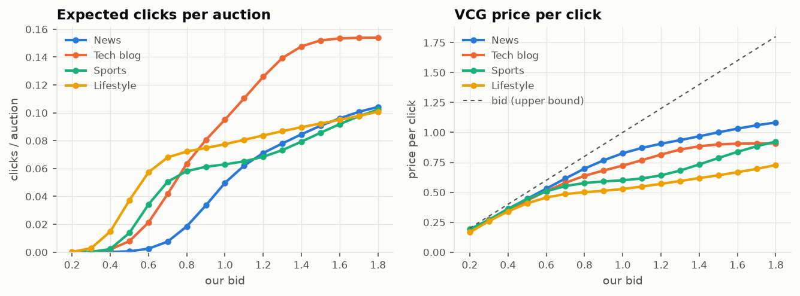
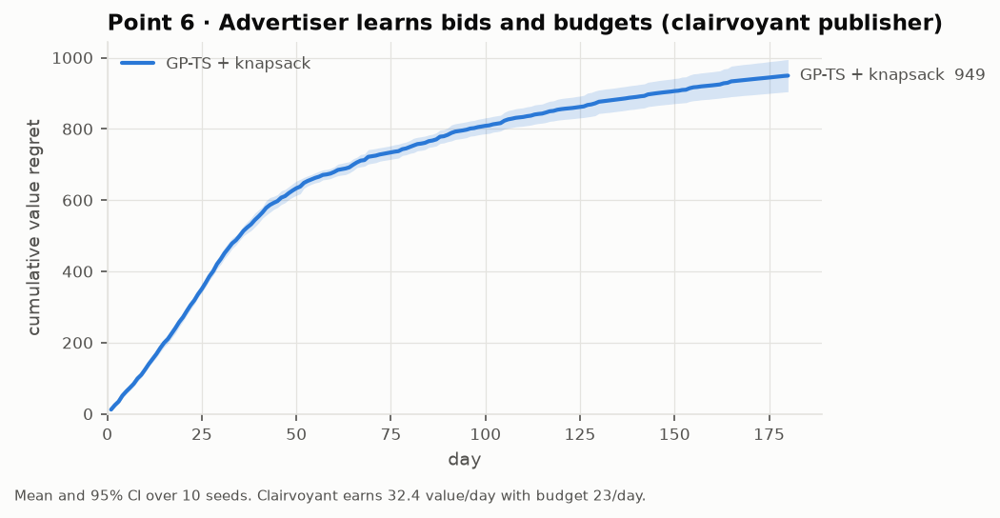
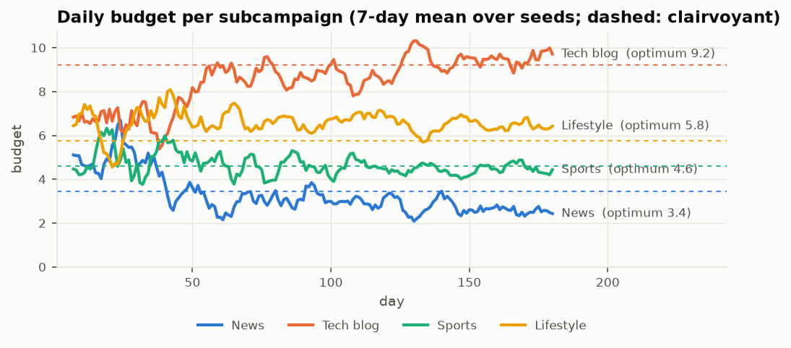
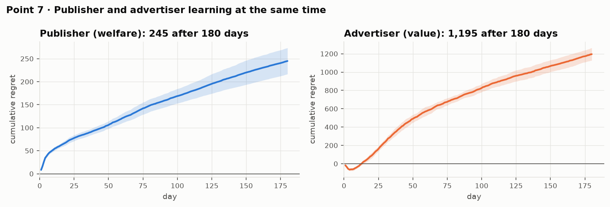

# Matching + Advertising with Online Learning

[](https://github.com/talipturkmen/dia-project/actions/workflows/tests.yml)


A simulation of an online ad market in which **both sides learn at the same time**:

- **Publishers** allocate ads to page slots by solving a bipartite matching problem. They do not know how often *our* ad gets clicked, so they learn it with combinatorial bandits and, later, with per-user-segment contexts.
- **Our advertiser** pays VCG prices. It learns which bid and which share of a fixed daily budget to give each website, using Gaussian-process Thompson sampling and a knapsack optimizer.

All seven parts of the *Data Intelligence Applications* project (Politecnico di Milano, 2020) are implemented and tested. Every regret curve is a mean over 10 seeds with a 95% confidence band.



## Results at a glance

| Part | What is learned | Algorithm | Cumulative regret (mean ± 95% CI) |
| --- | --- | --- | --- |
| 3 | Our ad's click probability per slot (publisher) | UCB1 / Thompson sampling in the matching | UCB1 **728 ± 17**, TS **394 ± 34** after 365 days |
| 4 | Same, per user segment | Weekly greedy context generation + TS | **1,332 ± 32** with contexts vs **1,996 ± 33** without (−33%) |
| 5 | — | VCG payments for the matching auction | price per click always ≤ bid (see figure) |
| 6 | Bid and budget per subcampaign (advertiser) | GP-TS per bid + multiple-choice knapsack | **949 ± 45** of a clairvoyant **5,826** over 180 days (16%); last 18 days: 4% |
| 7 | Both at once | TS publisher + GP-TS advertiser | publisher **245 ± 28**, advertiser **1,195 ± 68** |

The exact numbers are in [`results/summary.json`](results/summary.json). Rerunning `python -m dia run` reproduces them.

## The scenario

| | |
| --- | --- |
| Publishers | 4 websites (News, Tech blog, Sports, Lifestyle); one subcampaign of our product on each |
| Slots | 4 ad slots per page |
| Competing ads | 6 stochastic advertisers per website. Their click probabilities are known; bids are drawn per auction from a truncated normal |
| Users | Two binary features, **age** (young / older) and **device** (mobile / desktop). Their four combinations map to three hidden classes: *young*, *older · mobile*, *older · desktop* |
| Daily traffic | Poisson number of interested users (auctions) per feature combination, 150–170 per website per day |
| Click model | `q[i, j]` per ad and slot. **Not** factorized into ad × slot effects: each ad has its own slot-decay profile, and our ad's profile also depends on the user class (heatmap above) |

The scenario is generated from a fixed seed in [`scenario.py`](src/dia/scenario.py).

## Part 3 · Matching with an unknown click probability

The publisher's value for showing ad `i` in slot `j` is `q[i, j] · b[i]`. It assigns ads to slots with a maximum-weight matching. Our advertiser bids truthfully. The publisher does not know our `q[0, j]`, so every day it plugs an estimate into the matching:

- **UCB1**: optimistic upper confidence bound per slot (CUCB)
- **Thompson sampling**: a sample from a Beta posterior per slot

The super-arm is the whole assignment, and only the slot our ad lands in gives feedback (click or no click). Regret is the expected social welfare lost against a publisher that knows `q`.



Thompson sampling halves the regret. UCB1's exploration bonus shrinks slowly here, because click probabilities are small and most impressions go to one or two slots.

## Part 4 · Context generation

Every 7 days the publisher splits its users on the two features with a greedy tree. A split of context `X` is accepted only if

```text
p̲(X₁)·μ̲(X₁) + p̲(X₂)·μ̲(X₂)  ≥  μ̲(X)
```

`p̲` is a Hoeffding lower bound on a child's share of users. `μ̲` is the welfare our ad adds to the matching when its click probabilities are set to their lower confidence bounds; it is estimated by Monte Carlo over competitor bids. Because welfare is convex in `q`, splitting helps only when segments would be ranked differently, and the lower bounds keep the publisher from splitting on noise.





The publisher discovers what the scenario hides:

- **News and Tech blog** split into all three classes, where class differences change the best slot.
- **Lifestyle** splits young vs older.
- **Sports** stays unsplit: there the classes rank our ad almost the same way, so a split would not pay for its uncertainty.

## Part 5 · VCG payments

```text
p_i = SW*(without ad i) − (SW*(all ads) − value of ad i in the best allocation)
pay-per-click = p_i / q_i,slot
```

[`vcg_payments`](src/dia/matching.py) implements this rule for any matching. A vectorized version is used in the simulations. The tests check a hand-computed example and individual rationality (no ad ever pays more than its value).



Higher bids win better slots (more clicks per auction), but the VCG price per click rises with them. The price stays below the bid (dashed line), as VCG guarantees.

## Part 6 · Bids and budgets, with a clairvoyant publisher

Every day the advertiser picks a **bid** (0.4 to 1.4) and a **budget** (21 levels of a total daily budget of 23) for every subcampaign. It aims to maximize the value of its clicks. Clicks are paid at the VCG price until the subcampaign's budget runs out.

1. For each subcampaign and bid, a **Gaussian process** models clicks as a function of budget. Each GP is anchored at "no budget, no clicks".
2. Each day every GP is Thompson-sampled. At every budget level the best bid is kept, and a **multiple-choice knapsack** (dynamic program) splits the total budget across subcampaigns.
3. The day's spend timeline shows how many clicks every *smaller* budget would have bought. Each day therefore yields up to 21 observations, not one, which speeds learning a lot.





The learned split converges to the clairvoyant one: most budget goes to Tech blog, the least to News, where clicks are most expensive.

## Part 7 · Publisher and advertiser learning together

The publisher learns our click probabilities (Thompson sampling, no contexts) while the advertiser learns bids and budgets. Each side's regret is measured against its own clairvoyant.



The advertiser's regret starts **negative**: the publisher is not yet sure of our click probability and samples high values for it. That puts our ad in better slots and lowers the price per click (`payment / q̂`), so for the first days our advertiser does *better* than against a clairvoyant publisher. As the publisher learns, prices rise to their true level. From then on the advertiser is learning in a non-stationary market, which is why its regret stays above Part 6's.

## Run it

Requires Python 3.10+.

```sh
pip install -e ".[dev]"

python -m dia run                    # all parts, 10 seeds, ~1 minute on 8 cores
python -m dia run --steps 3 4        # selected parts
python -m dia run --quick            # 2 seeds, short horizons (smoke test)
pytest                               # 23 tests
```

Figures are written to `figures/` and the numbers to `results/summary.json`.

## Code layout

```text
src/dia/
  scenario.py      publishers, slots, user classes, competitors (fixed seed)
  matching.py      Hungarian algorithm, batched exact matching, VCG payments
  knapsack.py      multiple-choice knapsack for the budget split
  learners.py      UCB1 / Thompson sampling slot learners, GP Thompson sampling
  context.py       greedy context generation with lower-bound split tests
  experiments.py   parts 3-7
  plotting.py      figures
  cli.py           `python -m dia run`
tests/             matching vs SciPy, VCG properties, knapsack vs brute force, learners, contexts, CLI
legacy/            the original 2020 code (see below)
```

**Matching.** `hungarian()` is a from-scratch O(n²m) Hungarian algorithm. The simulations use `batch_assign` instead: with 7 ads and 4 slots there are only 840 possible assignments, so it scores all of them for a whole day's auctions at once. That keeps the welfare, regret and VCG calculations vectorized across auctions. The tests check both against `scipy.optimize.linear_sum_assignment`.

## History

This started as a 2020 team project for *Data Intelligence Applications* at Politecnico di Milano. The original code is kept in [`legacy/`](legacy/) and tagged [`v2020-original`](https://github.com/talipturkmen/dia-project/tree/v2020-original). It covered the environment and a first GP-TS + knapsack loop. It did not run the experiments end to end: a `return` inside the time loop stopped every experiment after day 1, and the Hungarian algorithm crashed on a global variable. Parts 3, 4, 5 and 7 were not implemented. In 2026 the project was rebuilt from the original design and completed.

## Team

- Talip Turkmen ([@talipturkmen](https://github.com/talipturkmen))
- Anne Daniele Durif ([@anne-durif](https://github.com/anne-durif))
- Julian Andreas Haug ([@Schneeflittchen](https://github.com/Schneeflittchen))
- Alireza Fathollah Pour
- Chindwendu Jane Ahanonu
